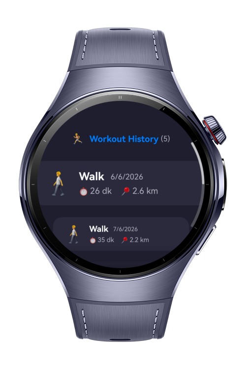
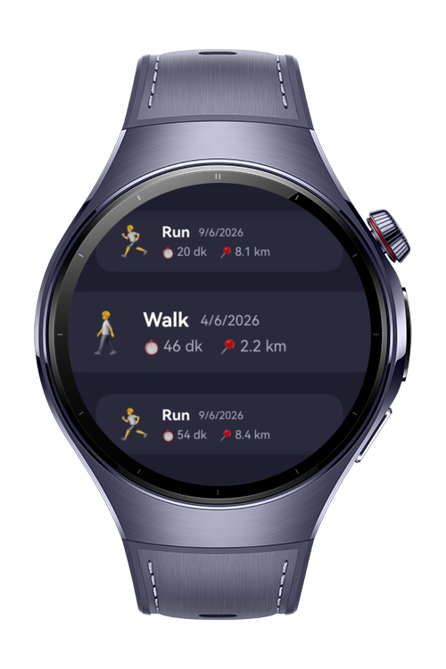

> **Note:** To access all shared projects, get information about environment setup, and view other guides, please visit [Explore-In-HMOS Index](https://github.com/Explore-In-HMOS/hmos-index).

# How To Build Local Database

`How To Build Local Database` is a HarmonyOS Next fitness tracking application designed for smart wearables (Huawei Watch 5). It demonstrates local relational database management using RDB Store (ArkData) with features including workout tracking, heart rate monitoring, and GPS location data persistence. The app generates mock fitness data to simulate workout sessions without requiring actual sensors.

# Preview

<div>
  
  
</div>

# Use Cases
- **Track Workout Sessions**: Users can record running and walking workouts with duration and distance information
- **View Workout History**: Display all past workouts in a scrollable list optimized for circular watch screens
- **Generate Mock Data**: Automatically create random workout data for testing and demonstration purposes
- **Persist Data Locally**: Store all fitness data locally using HarmonyOS RDB Store (ArkData)
- **Clear Data**: Remove all workout records with a single tap when needed
- **Quick Add Workout**: Add new workout entries instantly using the "Add" button
- **View Workout Details**: Tap on any workout card to see detailed information via toast notification
- **Database Transactions**: Demonstrate ACID-compliant database operations with transaction support

# Technology

## Stack

| Category | Technologies |
|----------|--------------|
| **Language** | ArkTS (TypeScript-based) |
| **Framework** | HarmonyOS Next |
| **UI Components** | ArkUI (ArcList, Column, Row, Button, Text) |
| **Database** | ArkData (@kit.ArkData) - Relational Database (RDB) Store |
| **Data Structures** | ValuesBucket, RdbPredicates, ResultSet |
| **Permissions** | None required (local storage only) |
| **Development IDE** | DevEco Studio |
| **Target SDK** | API 18+ |

## Required Permissions
No special permissions are required for this application as all data is stored locally on the device. The app does not access:
- Network/Internet
- Location services (uses mock GPS data)
- Heart rate sensors (uses mock heart rate data)
- Storage (RDB handles internal storage automatically)

# Directory Structure

```
entry/
├── src/
│ ├── main/
│ │ ├── ets/
│ │ │ ├── entryability/
│ │ │ │ └── EntryAbility.ets # Application lifecycle
│ │ │ ├── pages/
│ │ │ │ └── Index.ets # Main UI with ArcList
│ │ │ └── database/
│ │ │ └── FitnessRdbHelper.ets # RDB operations (CRUD)
│ │ └── resources/
│ │ └── base/
│ │ ├── element/
│ │ │ ├── color.json # Color definitions
│ │ │ └── string.json # String resources
│ │ └── profile/
│ │ └── main_pages.json # Page routing
├── module.json5 # Module configuration
└── build-profile.json5 # Build configuration
```

# Constraints and Restrictions

## Supported Devices

- **Huawei Watch 5** - Circular screen wearable device (optimized)
- **Huawei Watch 4 Series** - Compatible with circular display
- **Huawei Watch GT Series** - With circular display support
- **DevEco Studio Simulator** - Wearable round screen simulator

# License (MIT)

**How To Build Local Database** is distributed under the terms of the MIT License.
See the [LICENSE](./LICENSE) for more information.